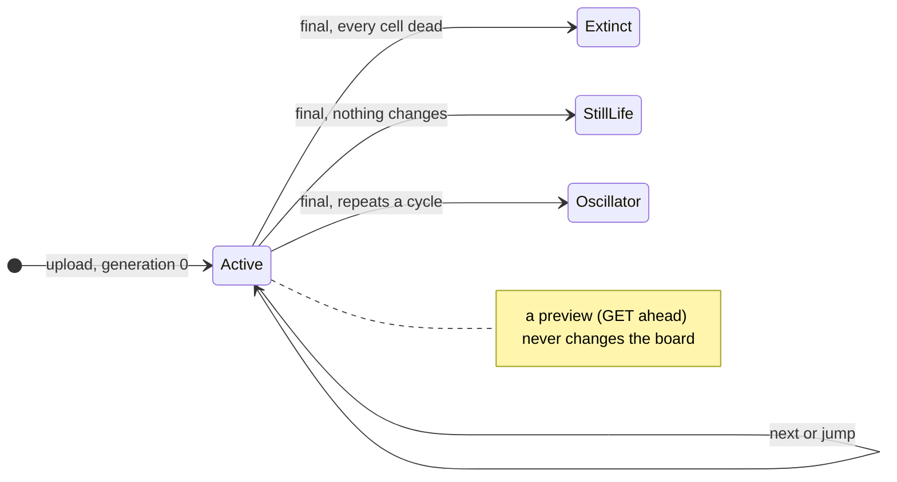
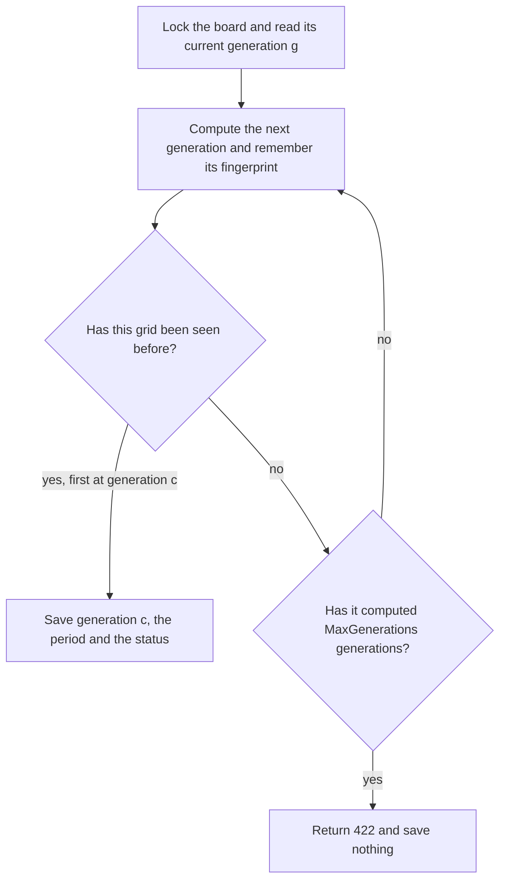
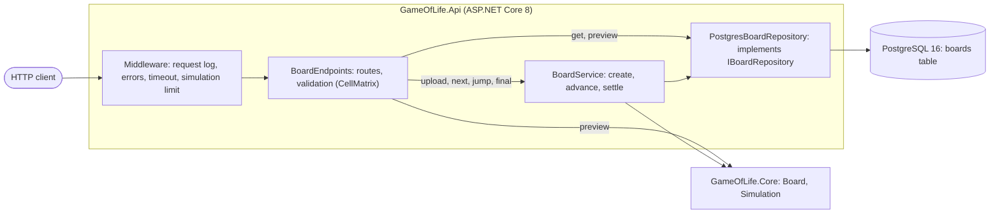
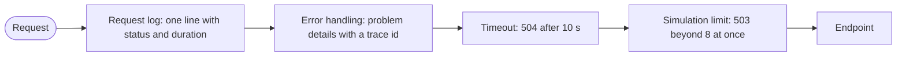
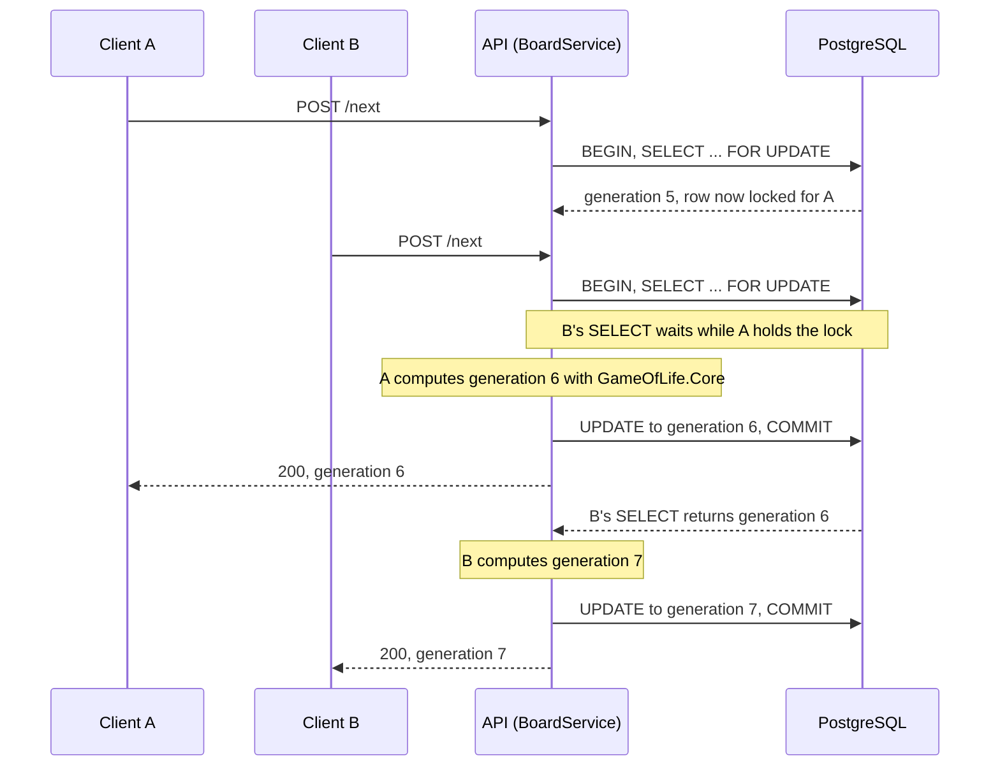
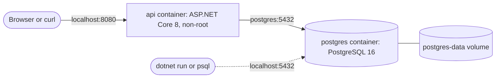

# Conway's Game of Life API

A REST API for [Conway's Game of Life](https://en.wikipedia.org/wiki/Conway%27s_Game_of_Life), written in C# on .NET 8. Upload a board and the API stores it. You can then advance it one generation or many, preview future generations without changing anything, and find the state it finally settles into. Boards are stored in PostgreSQL, so they survive restarts and crashes.

- [Quick start](#quick-start)
- [How the requirements are met](#how-the-requirements-are-met)
- [API](#api)
- [How boards evolve](#how-boards-evolve)
- [Architecture](#architecture)
- [Design decisions](#design-decisions)
- [Limits and configuration](#limits-and-configuration)
- [Resilience and observability](#resilience-and-observability)
- [Development](#development)
- [Limitations and next steps](#limitations-and-next-steps)

## Quick start

You need Docker (Docker Desktop, or Colima on macOS). This starts the API and PostgreSQL:

```sh
docker compose up -d --build
```

Then open http://localhost:8080/swagger, or try it with curl:

```sh
# Upload a vertical blinker. The id is the first field of the response.
id=$(curl -s -X POST http://localhost:8080/api/v1/boards \
  -H 'Content-Type: application/json' \
  -d '{"cells":[[0,1,0],[0,1,0],[0,1,0]]}' | cut -d '"' -f 4)

curl -s -X POST http://localhost:8080/api/v1/boards/$id/next      # generation 1: the blinker turns horizontal
curl -s         http://localhost:8080/api/v1/boards/$id/ahead/3   # preview generation 4; nothing is saved
curl -s -X POST http://localhost:8080/api/v1/boards/$id/ahead/3   # jump to generation 4 and save it
curl -s -X POST http://localhost:8080/api/v1/boards/$id/final     # it settles as an oscillator with period 2
curl -s -X POST http://localhost:8080/api/v1/boards/$id/next      # 409: a settled board cannot advance
```

`docker compose down` stops everything and keeps the data. `docker compose down -v` deletes the data too.

## How the requirements are met

| Requirement | How it is met |
|---|---|
| Upload a board state and return a unique id | `POST /api/v1/boards` validates the grid and stores it as generation 0. It returns `201 Created` with the board's id and a `Location` header. |
| Get the next state | `POST /api/v1/boards/{id}/next` computes the next generation and saves it as the board's current state. |
| Get the state N generations ahead | `GET /api/v1/boards/{id}/ahead/{n}` previews that generation without saving anything. `POST` on the same URL jumps the board there and saves it. |
| Get the final state, or an error if there is none within a reasonable number of iterations | `POST /api/v1/boards/{id}/final` finds the cycle the board settles into and saves it. If no generation repeats within 1,000 generations, it returns `422`, including the limit, and saves nothing. |
| Persist boards so they survive restarts and crashes | Boards are stored in PostgreSQL, and every change is a single transaction. Tests restart the app, and the container has been killed outright, without losing a board. |
| Clean, modular, testable code | The rules live in a library with no dependencies. HTTP, application logic and storage are separate, and storage sits behind an interface. Unit tests cover the rules and integration tests cover the API. |
| Error handling and validation | Every error is an RFC 9457 problem response that carries a trace id. A rejected grid names the field that is wrong, for example `cells[1]`. |
| Production readiness | Limits are configurable and checked at startup. A cap on simultaneous simulations, request timeouts and an upload size limit protect the service. It has health checks and structured logs, and the container runs as a non-root user. |

## API

Routes are versioned under `/api/v1`, so a breaking change could ship as `v2` alongside the current version.

| Method | Path | What it does | Status codes |
|---|---|---|---|
| `POST` | `/api/v1/boards` | Uploads a board, which is saved as generation 0 with status `Active` | 201, 400, 413, 415 |
| `GET` | `/api/v1/boards/{id}` | Returns the board's current generation and status | 200, 404 |
| `POST` | `/api/v1/boards/{id}/next` | Advances the board one generation and saves it | 200, 404, 409, 503 |
| `GET` | `/api/v1/boards/{id}/ahead/{n}` | Previews the generation `n` after the current one (0 to 1,000) without saving it | 200, 400, 404, 503 |
| `POST` | `/api/v1/boards/{id}/ahead/{n}` | Jumps `n` generations ahead (1 to 1,000) and saves the result | 200, 400, 404, 409, 503 |
| `POST` | `/api/v1/boards/{id}/final` | Finds and saves the final state. Calling it again returns the saved state unchanged | 200, 404, 422, 503 |
| `GET` | `/health/live` | Reports that the process is up | 200 |
| `GET` | `/health/ready` | Reports that the database answers too | 200, 503 |

Any board endpoint can also return 400 for an id that is not a GUID, 503 if the database cannot be reached, and 504 if it runs past the request timeout. Requests that change a board are `POST`s; requests that only read are `GET`s, so they are safe to repeat.

### Requests and responses

An upload is a list of rows, top row first. Each row is a list of cells, `1` for live and `0` for dead:

```json
{ "cells": [[0, 1, 0], [0, 1, 0], [0, 1, 0]] }
```

Every row must have the same length. A board can have 1 to 256 rows and 1 to 256 columns; both limits are configurable. Cells must be JSON numbers, so `"1"` is rejected rather than converted. The request body may be at most 1 MiB.

Upload, get, next, jump and final all respond with the board as it is now stored. This is the response to `next` above:

```json
{
  "id": "10d53d29-2b68-42c5-b9a4-c66822a019f9",
  "generation": 1,
  "status": "Active",
  "rows": 3,
  "columns": 3,
  "liveCells": 3,
  "cells": [
    [0, 0, 0],
    [1, 1, 1],
    [0, 0, 0]
  ]
}
```

A settled board also has a `period`. This is the response to `final`:

```json
{
  "id": "10d53d29-2b68-42c5-b9a4-c66822a019f9",
  "generation": 4,
  "status": "Oscillator",
  "period": 2,
  "rows": 3,
  "columns": 3,
  "liveCells": 3,
  "cells": [
    [0, 1, 0],
    [0, 1, 0],
    [0, 1, 0]
  ]
}
```

A preview (`GET ahead/{n}`) has the same fields except `status` and `period`, because it describes a generation that is not stored.

| Field | Meaning |
|---|---|
| `generation` | The generation shown. The upload is generation 0, and each generation follows from the one before it. |
| `status` | `Active` until the final state is saved. After that, how the board settled: `Extinct` (every cell is dead), `StillLife` (live cells remain but nothing changes) or `Oscillator` (it repeats a cycle of two or more generations). |
| `period` | For a settled board, how many generations its cycle takes. It is 1 for `Extinct` and `StillLife`. |
| `liveCells` | How many cells are alive. |
| `cells` | The grid: rows top to bottom, `1` for live and `0` for dead. |

### Errors

Every error is a problem details response (RFC 9457, `application/problem+json`) with a `traceId` that also appears in the server's logs:

```json
{
  "type": "https://tools.ietf.org/html/rfc9110#section-15.5.10",
  "title": "Board has settled",
  "status": 409,
  "detail": "The board settled at generation 4 as Oscillator, so it cannot advance. GET the board to see its final state.",
  "boardStatus": "Oscillator",
  "generation": 4,
  "traceId": "00-49c17c4d5c94034f96b6bc652184b39f-66ae6493b586fa69-00"
}
```

A rejected upload names the field that is wrong. The validator reports the first problem it finds, so the error can never be as large as the board:

```json
{
  "type": "https://tools.ietf.org/html/rfc9110#section-15.5.1",
  "title": "One or more validation errors occurred.",
  "status": 400,
  "errors": {
    "cells[1]": ["Every row needs as many cells as the first row, which has 3; this one has 2."]
  },
  "traceId": "00-ef644e425eb3a8f0822bb46b4e711ea0-e176ba8f5bbdac53-00"
}
```

| Status | When |
|---|---|
| 400 | The grid is invalid (`errors` names the field), `n` is out of range, the JSON is malformed, or the id is not a GUID. |
| 404 | No board has the id, or no route matches. |
| 405 | The method is wrong for the route, for example `GET /next`. |
| 409 | `next` or a jump was sent for a settled board. The response includes `boardStatus` and `generation`. |
| 413 | The request body is larger than 1 MiB. |
| 415 | The body was not sent as `application/json`. |
| 422 | `final` found no repeat within `maxGenerations`, which the response includes. Nothing was saved. |
| 503 | Too many simulations are running (the response includes `Retry-After: 1`), or the database cannot be reached (`Retry-After: 5`). |
| 504 | The request ran longer than the timeout, 10 seconds by default. Nothing was saved. |
| 500 | An unexpected failure. No internal details are returned. |

## How boards evolve

The rules are Conway's: a live cell with two or three live neighbours survives, a dead cell with exactly three comes alive, and every other cell is dead in the next generation. The grid does not wrap, so cells beyond the edges count as dead. A glider therefore crashes into a corner and becomes a block instead of travelling forever.

Generation numbers always mean the same thing. The rules are deterministic, so generation *k* of a board is the same grid whether it was reached with `next`, a jump or a preview. That is why a preview of generation 7 shows exactly what a jump to generation 7 saves.



`next` and jumps never settle a board, even when its grid stops changing. A block keeps coming back from `next` the same, one generation later each time and still `Active`, and a blinker keeps flipping. Only `final` finds where a board settles, so call it, or compare the cells with the previous response, to know when to stop.

A settled board refuses `next` and jumps with `409`. `final` returns it unchanged, and previews still work.

### The final state

`final` runs the board forward from its current generation, remembering a fingerprint of every grid it computes. The first time a grid repeats, the board will cycle through the same generations forever. The final state is the first generation of that cycle, and the period is the cycle's length.



A fingerprint is a SHA-256 hash of the grid's cells, so the search needs little memory however large the board. Equal grids always have equal fingerprints, so a repeat is never missed; two different grids would only be mistaken for a repeat if their hashes collided, which is too unlikely to matter. Only the current generation is stored, so the cycle cannot be found to start before the generation where `final` was called. For example, a blinker advanced to generation 1 settles at generation 1, even though generation 0 was already part of its cycle.

A board that needs more than `MaxGenerations` generations to settle gets `422` and is left exactly as it was, so calling `final` again repeats the same search with the same result. Each search starts from the board's current generation, so jumping the board ahead and then calling `final` reaches further. An R-pentomino on a 68 x 68 board, for example, does not settle within 1,000 generations of generation 0, but after `POST /api/v1/boards/{id}/ahead/1000`, `final` finds that it settles at generation 1,163. The jump is saved like any other change, so the board cannot go back to its earlier generations.

## Architecture

The solution has two projects plus tests:

- **`GameOfLife.Core`** holds the rules: the board, one generation's step, advancing N generations and finding the final state. It has no dependency on ASP.NET Core, the database or any package.
- **`GameOfLife.Api`** holds the HTTP endpoints, validation, the application service, PostgreSQL storage, configuration, health checks and `Program.cs`, which wires them together.



`BoardService` makes every change to a board. It returns a `BoardUpdateResult`, a closed set of outcomes (succeeded, not found, already settled, did not settle), and the endpoints map each outcome to exactly one HTTP response. Reads skip the service and go straight to the repository.

### The request pipeline



The request log is outermost, so it records the final status and the full duration. Error handling wraps everything inside it, so a timeout or a rejection also gets a problem body. The simulation limit applies only to `next`, `ahead` and `final`.

### Changing a board

Every change locks the board's row before reading it, and keeps the lock until it commits:



Changes to the same board happen one at a time, and none is lost. Changes to other boards never wait, and neither do reads, because PostgreSQL readers do not block on row locks. An abandoned change, whether from a 422, an error, a timeout or a disconnected client, rolls back and releases the lock. If the process dies, PostgreSQL releases the lock when the connection drops.

### Running with Docker



Compose starts the API only after PostgreSQL reports healthy, and restarts either container if it stops. Both ports are published on the loopback interface only.

## Design decisions

| Decision | Alternatives considered | Why |
|---|---|---|
| Boards move forward: `next`, jumps and `final` save the new state | Never change the upload, and compute every generation from generation 0 | "Next" reads as stepping a simulation, and the requirement to survive restarts matters most when a board has progress to lose. |
| `POST` for changes, `GET` for reads, including previews | `GET` for everything named "Get" in the requirements | HTTP treats a `GET` as safe to repeat, and caches, proxies and retry logic rely on that. A request that changes a board cannot be a `GET`. |
| One row per board, overwritten on every change | Keep every generation | The requirements need only the current state, and a history would grow with every `next`. |
| Cells stored as text, one line per row with `O` for live and `.` for dead | JSON in a `json` or `jsonb` column | It is smaller and faster to store than JSON: a random 256 x 256 board takes about 14 KB, against 21 KB as `json` and 81 KB as `jsonb`, which is also about five times slower to save and load. It reads as a picture in `psql`. JSON would let SQL look inside a board and check its shape, but boards are only ever read and written whole. |
| A row lock (`SELECT ... FOR UPDATE`) for every change | A version check with retries; PostgreSQL advisory locks | The database enforces a row lock for every writer and releases it automatically. Retries could redo up to a second of work on a conflict. Advisory locks only constrain code that remembers to take them, and they need hashed keys, pinned connections and explicit unlocking. |
| No separate wait limit for the lock | A `lock_timeout` with its own error | The request timeout already bounds every wait, and the simulation cap bounds how many requests can be waiting, so one mechanism covers both. |
| Turn excess simulations away with 503 | Queue them | It puts a hard ceiling on CPU use and on database connections held, so a burst cannot pile up. |
| Plain SQL through Npgsql | Entity Framework Core | There is one table and four statements, and the locking is visible in the code. |
| An immutable board stored as an `int[][]` of 1s and 0s | Bits packed 64 cells to a `ulong` | It is the same shape as the API's cell matrix, and reading a cell is plain indexing. Bits would take 32 times less memory per board, but only a few boards exist at a time because the final-state search keeps fingerprints, not boards. Copying the matrix in and out keeps boards immutable, which makes them safe to share between threads. |
| Cycle detection with a history of SHA-256 fingerprints | Keeping every grid and comparing exactly; Brent's algorithm | A fingerprint is 64 characters however large the board, so at the default limits the history takes about 200 KiB; keeping every grid as `int[][]` would take about 256 MiB. A false repeat would need a SHA-256 collision. Brent's algorithm needs constant memory but computes two to three times as many generations. |
| The final state is the first generation of the cycle | The generation where the repeat was noticed | The response then says where the board settled. |
| Edges are dead | A grid that wraps around | This is the usual reading of a bounded board. Tests pin it down. |
| Minimal APIs with typed results | MVC controllers | This is the recommended style for small APIs in .NET 8, and the typed return values describe every response to OpenAPI. |
| Outcomes as a closed set of result types | Exceptions | "Board not found" and "did not settle" are expected outcomes, not failures. In .NET 8 the exception handler also logs every exception it handles as an error. |
| The app creates its table at startup | A separate migration step | The app runs against an empty database with no setup. See the [limitations](#limitations-and-next-steps) for multiple instances. |

## Limits and configuration

Settings live in [`appsettings.json`](src/GameOfLife.Api/appsettings.json). Environment variables override them, using `__` for each level, for example `GameOfLife__MaxGenerations=2000`. Invalid values stop the app at startup.

| Setting | Default | What it controls |
|---|---|---|
| `GameOfLife:MaxRows`, `GameOfLife:MaxColumns` | 256 | The largest board accepted (1 to 10,000). |
| `GameOfLife:MaxGenerations` | 1000 | The largest `n` for `ahead`, and how far `final` searches (1 to 1,000,000). |
| `GameOfLife:MaxConcurrentSimulations` | 8 | How many `next`, `ahead` and `final` requests run at once; more get 503. Every one except a preview holds a database connection while it runs, so the setting is limited to 1 to 100, the size of Npgsql's default pool. |
| `GameOfLife:RequestTimeoutSeconds` | 10 | How long any request may run before it gets 504 (1 to 3,600). |
| `Kestrel:Limits:MaxRequestBodySize` | 1048576 | The largest request body; larger ones get 413. A full 256 x 256 board is about 130 KB. |
| `ConnectionStrings:GameOfLife` | none | The PostgreSQL connection string. Development and `compose.yaml` set one; any other environment must provide it. |
| `Swagger:Enabled` | `false` | Serves `/swagger`. Development and `compose.yaml` turn it on. |

The defaults come from measurements of the core on an Apple Silicon Mac, with a Release build:

| Board | One generation | `final`, 1,000 generations | `final`'s history at 1,000 generations |
|---|---|---|---|
| 64 x 64 | 0.05 ms | 0.07 s | 0.2 MiB |
| 256 x 256 | 0.84 ms | 1.0 s | 0.2 MiB |
| 512 x 512 | 3.5 ms | 4.2 s | 0.2 MiB |

`final` also hashes every generation, which costs about 0.2 ms per generation at 256 x 256. Its history is the same size for every board, because it keeps a 64-character fingerprint per generation rather than the grid.

At the defaults, the slowest request takes about a second of CPU and the timeout allows ten.

## Resilience and observability

- **Crashes and restarts.** Every change is one transaction, so it is either committed or never happened. Committed generations survive a restart of the app (there is a test for it) and `docker compose kill api` (checked by hand).
- **Abandoned work.** A request cut short by the timeout, a disconnect or a crash saves nothing, and its computation stops. The request's cancellation token is checked between generations, and it also cancels any SQL that is waiting for a lock.
- **Database outages.** `/health/ready` returns 503, so a load balancer stops sending traffic. `/health/live` deliberately does not check the database, because restarting a healthy API would not bring the database back. Board requests that arrive during the outage get 503 with `Retry-After` rather than 500, and the API recovers by itself once the database is back.
- **Retries.** `next` and jumps are not idempotent: retrying after a lost response advances the board again, so `GET` the board first. `final` can be repeated safely.
- **Logs.** The app writes one line per request (method, path, status and duration), one line for each board created, advanced or settled, and a warning when a request is turned away. In production the logs are JSON with the trace and span ids attached. In Development they are single human-readable lines.
- **Trace ids.** An error's `traceId` is a W3C trace context id. Its 32-character middle part is the `TraceId` on the matching log lines.

## Development

### Prerequisites

- **.NET 8 SDK.** [`global.json`](global.json) selects an 8.0 SDK.
- **Docker.** The API tests start a temporary PostgreSQL in Docker, and the local database runs there too.

### Running the API outside Docker

```sh
docker compose up -d postgres                # just the database
dotnet run --project src/GameOfLife.Api      # http://localhost:5180/swagger
```

[`GameOfLife.Api.http`](src/GameOfLife.Api/GameOfLife.Api.http) has ready-made requests for the REST clients in Visual Studio, Rider and VS Code.

### Building and testing

```sh
dotnet build
dotnet test                         # the API tests need Docker running
dotnet format --verify-no-changes
```

The build treats warnings as errors and runs the .NET code analyzers. Package versions are managed centrally in [`Directory.Packages.props`](Directory.Packages.props).

The tests:

- **Core unit tests** cover:
  - every case of the rules, for a live and a dead cell with 0 to 8 live neighbours;
  - still lifes, and oscillators with periods of 2, 3 and 15;
  - gliders and the edges;
  - known results, for example that Diehard dies out at generation 130;
  - a comparison with a brute-force search on 300 random boards.
- **API integration tests** run the real app in memory with `WebApplicationFactory`, against a real PostgreSQL started by Testcontainers. Each test host gets a database of its own.
- **Concurrency tests are deterministic.** A test holds a board's row lock itself, which puts a request into a known state: waiting for the lock, timing out, or holding the only simulation slot.
- **A restart test** has a second app instance read back boards written by the first.
- **Every protection was checked by breaking it.** Removing the row lock, the commit, the timeout, the simulation limit, the trace id or the upload limit each makes a test fail.

### Project layout

```text
src/
  GameOfLife.Core/          The rules: Board, Simulation, FinalState
  GameOfLife.Api/
    Boards/                 Endpoints, request and response types, validation, BoardService, simulation limit
    Persistence/            IBoardRepository, the PostgreSQL implementation, the table definition
    Configuration/          GameOfLifeOptions, the validated limits
    Errors/                 Error responses: 503 when the database cannot be reached
    Health/                 The database readiness check
    Program.cs              Service registration and the request pipeline
tests/
  GameOfLife.Core.Tests/    Unit tests for the rules
  GameOfLife.Api.Tests/     Integration tests against PostgreSQL
compose.yaml                The API and PostgreSQL for local use
Dockerfile                  Two-stage build; runs as a non-root user
```

## Limitations and next steps

- **Several instances on an empty database.** The app creates its table at startup with `CREATE TABLE IF NOT EXISTS`, which is enough for one instance. Several instances starting at the same moment against an empty database could race to create it, so a deployment like that should create the schema in a separate migration step.
- **Simulations run inside the request.** That is fine within the configured limits, but much larger boards or generation counts should move to background jobs that clients poll.
- **Retried changes advance twice.** Idempotency keys, or an `If-Match` header carrying the expected generation, would make retries of `next` and jumps safe.
- **No history.** Only the current generation is stored, so a board cannot be rewound, and `final` cannot report a cycle that started before it was called.
- **Boards are kept forever.** Nothing deletes a board, so the table only grows. A `DELETE` endpoint, or a retention job that removes boards whose `updated_at` is old, would bound it.
- **Memory grows with the search.** `final` keeps a fingerprint of every grid it computes, about 200 bytes each. Brent's algorithm would make that memory constant.
- **Out of scope.** There is no authentication, per-client rate limiting or TLS. TLS usually ends at a proxy in front of the service.
- **Very large or sparse boards.** A sparse representation, or the HashLife algorithm, would scale far beyond a dense grid.

## License

[MIT](LICENSE)
